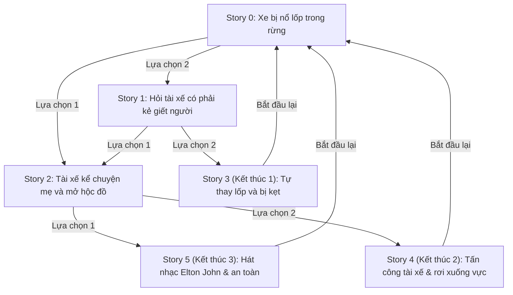

# Destini - Ứng Dụng Câu Chuyện Tương Tác (Flutter)

Destini là một ứng dụng Flutter cho phép người dùng trải nghiệm câu chuyện tương tác dạng **"chọn lựa hành động"** (Choose Your Own Adventure).

---

## 🎯 Chức năng chính

1. **Hiển thị nội dung câu chuyện**:
   - Khung văn bản chính hiển thị nội dung câu chuyện (`storyTitle`).
   - Hai lựa chọn tương ứng cho người dùng (`choice1` và `choice2`).

2. **Điều hướng logic câu chuyện**:
   - Sử dụng mô hình hướng đối tượng với các thuộc tính `nextStory1`, `nextStory2` trong đối tượng `Story`.
   - Lớp `StoryBrain` quản lý trạng thái (`_storyNumber`), danh sách dữ liệu (`_storyData`) và điều hướng người chơi qua từng phân đoạn.

3. **Tùy biến hiển thị khi kết thúc**:
   - Khi câu chuyện đi đến các kết thúc (Index 3, 4, 5), widget `Visibility` tự động ẩn nút lựa chọn 2.
   - Nút lựa chọn 1 tự động chuyển thành **"Bắt đầu lại"** (Restart) với icon và màu sắc phù hợp, cho phép người chơi quay lại đầu câu chuyện (`_storyNumber = 0`).

---

## 📂 Cấu trúc mã nguồn

```text
lib/
│
├── main.dart           # Giao diện chính (UI), bố cục Column, Expanded, ElevatedButton và Visibility
├── story.dart          # Lớp mô hình Story (storyTitle, choice1, choice2, nextStory1, nextStory2)
└── story_brain.dart    # Bộ não quản lý logic câu chuyện, danh sách cốt truyện và chuyển đổi nhánh
```

---

## 🌳 Sơ đồ phân nhánh cốt truyện (Story Flow)



---

## 🚀 Hướng dẫn chạy ứng dụng

1. Đảm bảo máy tính đã cài đặt Flutter SDK.
2. Mở thư mục dự án trong terminal hoặc VS Code / Android Studio.
3. Chạy lệnh cài đặt thư viện:
   ```bash
   flutter pub get
   ```
4. Chạy ứng dụng trên thiết bị giả lập hoặc trình duyệt:
   ```bash
   flutter run
   ```
